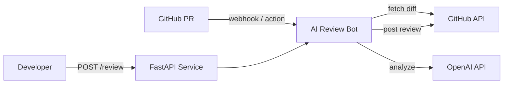

# AI Code Review Bot

Automated AI-powered code review for GitHub pull requests. Analyzes diffs for bugs, security issues, and code quality — then posts actionable inline comments directly on your PRs.

## Architecture



**Components:**

| Module | Purpose |
|--------|---------|
| `app/api/routes.py` | FastAPI endpoints (health, review, webhook) |
| `app/services/ai_reviewer.py` | OpenAI-powered code analysis engine |
| `app/services/github_client.py` | GitHub API client (PR files, reviews, HMAC verification) |
| `app/services/diff_parser.py` | Unified diff parser with line-position mapping |
| `app/services/review_service.py` | Orchestrator: fetch PR → AI review → post results |
| `app/scripts/run_review.py` | GitHub Actions entry point |
| `app/core/config.py` | Pydantic Settings configuration |

## Features

- **AI-Powered Review**: Analyzes code for correctness bugs, security vulnerabilities, performance issues, and readability
- **Inline PR Comments**: Maps findings to exact changed lines using GitHub's review API
- **Duplicate Detection**: Skips re-posting reviews on the same commit
- **Structured Output**: JSON-validated findings with severity, confidence, and suggested fixes
- **GitHub Actions Integration**: Automatic review on PR open/sync/reopen
- **Webhook Support**: HMAC-signed webhook endpoint for real-time PR events
- **Cost Controls**: Configurable limits on files, diff size, and comments per review
- **Binary/Lock File Filtering**: Automatically skips non-reviewable files
- **Graceful Degradation**: Handles rate limits, timeouts, and API errors without crashing

## Tech Stack

Python 3.12 · FastAPI · OpenAI SDK · httpx · Pydantic · GitHub REST API · GitHub Actions · pytest · Ruff

## Prerequisites

- Python 3.11+
- An OpenAI API key ([platform.openai.com](https://platform.openai.com))
- A GitHub token (for local PR review testing)

## Setup

### 1. Clone and create virtual environment

```powershell
git clone https://github.com/YOUR_USERNAME/ai-code-review-bot.git
cd ai-code-review-bot

python -m venv .venv
.\.venv\Scripts\Activate.ps1
pip install -r requirements.txt
```

### 2. Configure environment

```powershell
Copy-Item .env.example .env
```

Edit `.env` and set your real values:

```
OPENAI_API_KEY=sk-your-key-here
GITHUB_TOKEN=ghp_your-token-here
```

### 3. Start the server

```powershell
uvicorn app.main:app --reload
```

The API is now running at `http://localhost:8000`.

### 4. Verify it works

```powershell
# Health check
Invoke-RestMethod http://localhost:8000/health

# Review a code snippet
$body = @{
    diff = "+def add(a, b):`n+    return a - b  # BUG: should be a + b"
    file_path = "math_utils.py"
} | ConvertTo-Json

Invoke-RestMethod -Uri http://localhost:8000/review -Method Post -Body $body -ContentType "application/json"
```

With curl:

```bash
curl http://localhost:8000/health

curl -X POST http://localhost:8000/review \
  -H "Content-Type: application/json" \
  -d '{"diff": "+def add(a, b):\n+    return a - b", "file_path": "math.py"}'
```

## Running Tests

```powershell
# All tests (no API keys required)
python -m pytest tests/ -v

# With coverage
python -m pytest tests/ -v --tb=short

# Linting
python -m ruff check app/ tests/
```

## GitHub Actions Setup

The workflow at `.github/workflows/ai-code-review.yml` runs automatically on PRs.

### Required repository secrets

| Secret | Description |
|--------|-------------|
| `OPENAI_API_KEY` | Your OpenAI API key |

`GITHUB_TOKEN` is provided automatically by GitHub Actions.

### Optional repository variables

| Variable | Default | Description |
|----------|---------|-------------|
| `OPENAI_MODEL` | `gpt-4o-mini` | OpenAI model to use |
| `REVIEW_MAX_FILES` | `20` | Max files to review per PR |
| `REVIEW_MAX_COMMENTS` | `25` | Max inline comments per review |

### Setup steps

1. Push this repo to GitHub
2. Go to **Settings → Secrets and variables → Actions**
3. Add `OPENAI_API_KEY` as a repository secret
4. Open a test PR — the bot will automatically review it

### Security notes

- The workflow only runs on PRs from the **same repository** (not forks), preventing untrusted code from accessing secrets
- Uses least-privilege `contents: read` and `pull-requests: write` permissions
- Third-party actions are pinned to full commit SHAs
- PR content is treated as untrusted data — the AI prompt explicitly rejects instruction injection

## API Endpoints

| Method | Path | Description |
|--------|------|-------------|
| `GET` | `/health` | Health check |
| `GET` | `/` | Service info |
| `POST` | `/review` | Review a single diff |
| `POST` | `/review/pr` | Review an entire GitHub PR |
| `POST` | `/webhook/github` | GitHub webhook receiver |

### Example: Review a PR via API

```powershell
$body = @{
    owner = "octocat"
    repo = "hello-world"
    pr_number = 1
} | ConvertTo-Json

Invoke-RestMethod -Uri http://localhost:8000/review/pr -Method Post -Body $body -ContentType "application/json"
```

### Example AI Review Output

```json
{
  "summary": "Found 1 issue: a subtraction operator used where addition was intended.",
  "findings": [
    {
      "file": "math_utils.py",
      "line": 2,
      "severity": "high",
      "title": "Wrong arithmetic operator",
      "description": "Function returns a - b but is named 'add', suggesting a + b was intended.",
      "suggestion": "Change 'return a - b' to 'return a + b'.",
      "confidence": 0.95
    }
  ],
  "model": "gpt-4o-mini",
  "files_reviewed": 1
}
```

## Docker

```powershell
docker compose up --build
```

## Environment Variables

| Variable | Required | Default | Description |
|----------|----------|---------|-------------|
| `OPENAI_API_KEY` | Yes | — | OpenAI API key |
| `OPENAI_MODEL` | No | `gpt-4o-mini` | Model for reviews |
| `GITHUB_TOKEN` | For PR reviews | — | GitHub personal access token |
| `GITHUB_WEBHOOK_SECRET` | For webhooks | — | HMAC webhook secret |
| `REVIEW_MAX_FILES` | No | `20` | Max files per review |
| `REVIEW_MAX_DIFF_CHARS` | No | `50000` | Max diff characters sent to AI |
| `REVIEW_MAX_COMMENTS` | No | `25` | Max inline comments per review |
| `LOG_LEVEL` | No | `INFO` | Logging level |

## Troubleshooting

| Problem | Solution |
|---------|----------|
| `503 OpenAI API key not configured` | Set `OPENAI_API_KEY` in `.env` |
| `503 GitHub token not configured` | Set `GITHUB_TOKEN` in `.env` (only for `/review/pr`) |
| `401 Invalid signature` on webhook | Check `GITHUB_WEBHOOK_SECRET` matches your GitHub webhook config |
| `422 Validation Error` | Check request body matches the expected schema |
| Rate limit errors | The bot handles these gracefully; reduce `REVIEW_MAX_FILES` to lower API usage |
| Reviews not appearing on PR | Ensure the token has `pull-requests: write` permission |

## Cost Considerations

- Each review makes **one** OpenAI API call (all files combined), not one per file
- `gpt-4o-mini` is the default — cheapest option with good quality
- Use `REVIEW_MAX_FILES` and `REVIEW_MAX_DIFF_CHARS` to cap input size
- Binary files, lock files, and deleted files are automatically excluded

## Security Limitations

- The AI prompt treats all repo content as untrusted, but LLM outputs are inherently non-deterministic
- Webhook signature verification uses HMAC-SHA256 with timing-safe comparison
- The GitHub Actions workflow does not run on fork PRs to prevent secret exfiltration
- No source code is stored beyond the lifetime of a single request

## Future Improvements

- GitHub App authentication (installation tokens, no PAT needed)
- Per-file language detection for better review prompts
- Configurable review focus (security-only, performance-only, etc.)
- Review caching to avoid re-reviewing unchanged files
- Support for GitLab and Bitbucket
